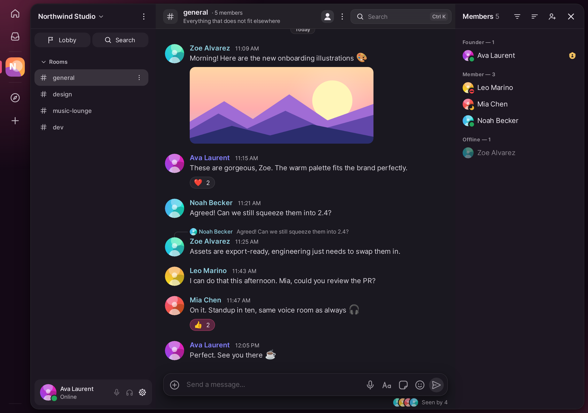
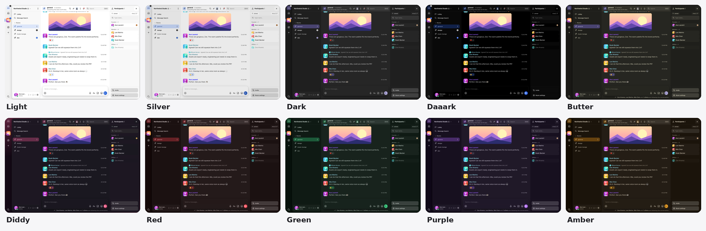
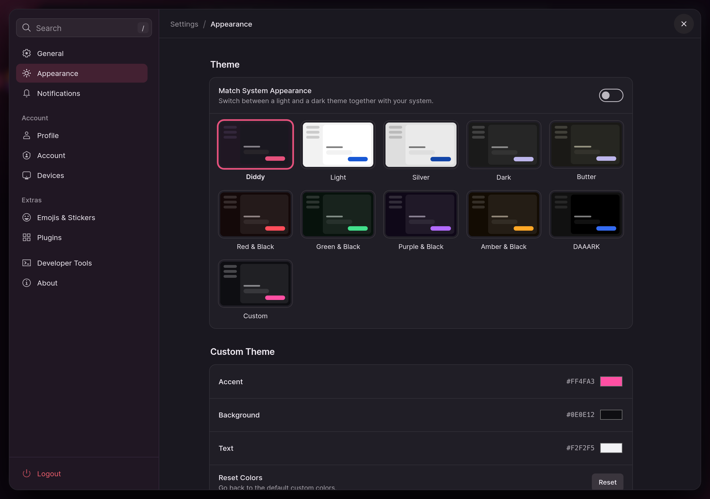
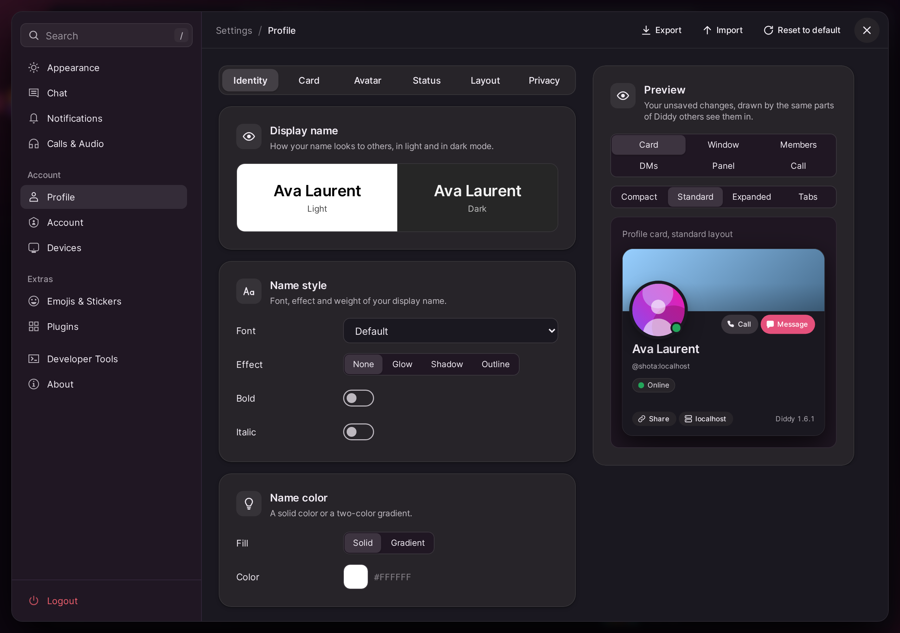

<div align="center">


# Diddy

**A Matrix chat client with voice calls that just work.**<br>
Themes, profiles, plugins and a calm interface. Built for macOS, Linux and iPhone/iPad.

[](../../releases/latest)
[](../../actions/workflows/test.yml)
[](LICENSE)


[**Download**](../../releases/latest) · [Features](#features) · [Install](#install) · [Build from source](#build-from-source) · [Changelog](CHANGELOG.md)

<br>



</div>

<br>

Diddy is built on [Cinny](https://github.com/cinnyapp/cinny) and adds what everyday chat with friends and teams needs: reliable voice calls, screen sharing with sound, rich profiles and a polished, themeable interface. It speaks plain [Matrix](https://matrix.org), so it works with any homeserver and with end-to-end encrypted rooms.

## Features

<table>
<tr>
<td width="33%" valign="top">

### Voice calls
Join a voice room in one click. Calls work on macOS, where Cinny's web client hangs, and on Linux, including encrypted rooms. Noise suppression is built in, and the headphone button mutes microphone and sound together.

</td>
<td width="33%" valign="top">

### Screen sharing
Streams stay sharp even when Diddy is in the background. Share with system audio on macOS 14.2+ and Linux, switch the sound on or off from the call bar, and pull any stream to the front with a click.

</td>
<td width="33%" valign="top">

### Profiles
Name colors, banners, badges and animated name plates. Everyone running Diddy sees them on the profile card, in the member list and in the chat.

</td>
</tr>
<tr>
<td valign="top">

### Ten themes
From Light and Silver to Dark, Daaark, Butter, Diddy, Red, Green, Purple and Amber. Pick one in *Settings → Appearance*, or follow the system.

</td>
<td valign="top">

### Plugins and sounds
A sandboxed plugin system with a built-in gallery (to-do, timer, calendar and more), a soundboard with MyInstants import, and a full set of app sounds you can switch off or replace.

</td>
<td valign="top">

### Status that means something
Online, Idle, Do Not Disturb and Invisible. Do Not Disturb silences message sounds, notifications and the call ring, and syncs across your devices.

</td>
</tr>
</table>

More details:

- **Chat:** voice messages that show up as voice messages in Element, a right-click menu with *Copy Text*, *Join All Rooms* for spaces, and a calm member list split by online and offline.
- **Music stays loud:** with *Voice processing* off, Diddy records the microphone directly through Core Audio, so macOS no longer ducks other apps when you join a call.
- **Call alerts:** on iOS, optional push alerts through [ntfy](https://ntfy.sh) ("Name is calling you") when someone calls and the app is closed.
- **Connection profiles:** if a homeserver is down, open another one in its own window with a separate login and data store. Your existing account and keys stay untouched.
- **No auto-update:** Diddy only changes when you install a new version.

Linux voice-message validation and the remaining X11/Wayland device checks are documented in [the test checklist](docs/linux-sprachnachrichten.md).

## Themes

Ten built-in themes, from light to dark (*Settings → Appearance*):



<br>

<table>
<tr>
<td width="50%"></td>
<td width="50%"></td>
</tr>
<tr>
<td align="center"><sub>Pick a theme</sub></td>
<td align="center"><sub>Design your profile card</sub></td>
</tr>
</table>

All images show example data and are generated from the real app, see [docs/screenshots](docs/screenshots/README.md).

## Platforms

| | macOS | Linux | iPhone / iPad |
|---|:---:|:---:|:---:|
| Chat, rooms, encryption | ✅ | ✅ Electron | 🧪 native app, new |
| Voice calls | ✅ | ✅ also encrypted | 🧪 |
| Screen sharing | ✅ | 🧪 Wayland portal / X11 picker | 🧪 full screen on iOS 27+, otherwise Diddy only |
| …with system sound | ✅ macOS 14.2+ | 🧪 other apps, not Diddy's own sound | 🧪 app sound |
| Connection profiles | ✅ macOS 14+ | 🧪 untested | 🧪 multiple accounts |
| Voice messages | ✅ | 🧪 | ❌ |
| Change app icon | ✅ | 🧪 | 🧪 |

✅ works and is tested · 🧪 built, but not yet tested in daily use · ❌ not supported (yet)

## Install

Downloads are on the [Releases](../../releases/latest) page. Pushing a version tag (`vX.Y.Z`) builds everything automatically: the macOS DMG, Linux AppImage, DEB and RPM, the iOS IPA and `SHA256SUMS`.

<details open>
<summary><b>macOS (Apple Silicon)</b></summary>

1. Open `Diddy_*_aarch64.dmg` and drag Diddy to *Applications*.
2. The app is not notarized yet, so run this once in a terminal:
   ```sh
   xattr -cr /Applications/Diddy.app
   ```
3. Start Diddy and allow the microphone. For stream sound, also allow *Screen & System Audio Recording*.

</details>

<details>
<summary><b>Linux</b></summary>

| Package | Command |
|---|---|
| AppImage | `chmod +x Diddy_*.AppImage && ./Diddy_*.AppImage` |
| Debian / Ubuntu | `sudo apt install ./Diddy_*.deb` |
| Fedora / openSUSE | `sudo dnf install ./Diddy_*.rpm` |
| NixOS | `nix run .#diddy` in a checkout, see the [NixOS guide](docs/nixos.md) (German) |

> [!NOTE]
> **AppImage:** needs FUSE 2 (`libfuse2` on Ubuntu 22.04, `libfuse2t64` on 24.04). Without it, run `./Diddy_*.AppImage --appimage-extract-and-run`. On Ubuntu 24.04 and newer, AppArmor restricts unprivileged user namespaces, so Chromium's sandbox can fail to start from an AppImage. Use the `.deb` there: it ships an AppArmor profile.
>
> All current Linux packages use Electron (Chromium): NixOS, AppImage, DEB and RPM. The packages are x86_64 only (CI builds no arm64 packages). System sound capture uses a bundled helper on top of PipeWire's PulseAudio interface or PulseAudio. When moving over from the old Tauri build, sign in once more and verify the new device; your old keys stay in the previous storage.

No Linux machine? You can try Linux and NixOS on a Mac with UTM: [VM guide](docs/vm-macos.md) (German).

</details>

<details>
<summary><b>iPhone / iPad</b></summary>

A native app in a Discord-like style (SwiftUI, matrix-rust-sdk, LiveKit), not a web view. The *Build iOS* workflow produces the IPA. Without a paid Apple account, install it with AltStore, SideStore or Sideloadly. Details, server requirements and build steps: [ios/README.md](ios/README.md).

The iOS app is in beta. Voice channels in encrypted rooms are end-to-end encrypted like Element Call, but without key rotation when someone leaves yet; devices get the media key from the LiveKit participant list. Hardening is planned ([ios/SECURITY-TODO.md](ios/SECURITY-TODO.md)).

</details>

### Apple emoji on Linux

On the Mac, Diddy shows Apple emoji. On Linux it uses the *Apple Color Emoji* font automatically once it is installed, and falls back to your system emoji (Noto) otherwise. *Settings → Appearance → Emoji* tells you whether the font was found.

> [!IMPORTANT]
> Apple emoji are Apple's artwork: not freely licensed and not redistributable. Diddy therefore does **not** ship them in any package. Install them for yourself and at your own responsibility.

With the community build [samuelngs/apple-emoji-ttf](https://github.com/samuelngs/apple-emoji-ttf):

```sh
mkdir -p ~/.local/share/fonts
curl -L -o ~/.local/share/fonts/AppleColorEmoji.ttf \
  https://github.com/samuelngs/apple-emoji-ttf/releases/latest/download/AppleColorEmoji-Linux.ttf
fc-cache -f
```

Restart Diddy afterwards. The file is over 100 MB. On **NixOS** there is an optional, unfree package (not part of the default `diddy` package):

```nix
fonts.packages = [ inputs.diddy.packages.${pkgs.system}.apple-color-emoji ];
```

## Report a bug

The most helpful thing is the log file. It lives at `~/Library/Logs/Diddy/app.log` on macOS, `~/.local/state/diddy/app.log` on Linux and `%LOCALAPPDATA%\Diddy\Logs\app.log` on Windows. In the app, *Settings → About → Diagnostics → Open Folder* opens the folder. The log contains technical events and errors, never message text.

## Build from source

**macOS:** Node 24, Rust and the [Tauri prerequisites](https://v2.tauri.app/start/prerequisites/).

```sh
(cd cinny && npm ci) && npm ci && npm run tauri -- build
```

**Linux:** `(cd cinny && npm ci && npm run build)`, then `(cd electron && npm ci && npm run dist:linux)` (needs a C compiler, pkg-config and libpulse development files). **NixOS:** `nix build .#diddy`. For development with Electron see the [NixOS guide](docs/nixos.md#entwicklung-und-prüfung) (German).

Tests that need no hardware:

```sh
cd cinny && npm test                                  # JavaScript
cd electron && npm test                               # Linux shell (Electron)
cd src-tauri && cargo test --lib -- --test-threads=1  # native
cd cinny && npm run build && npm run test:e2e         # browser smoke test (Playwright, Chromium)
```

On macOS, start the native tests with `DYLD_LIBRARY_PATH=/usr/lib/swift`.

## License

[AGPL-3.0](LICENSE), like Cinny.

---

<div align="center">

**Diddy** · built on [Cinny](https://github.com/cinnyapp/cinny) and [Tauri 2](https://tauri.app/)

</div>
