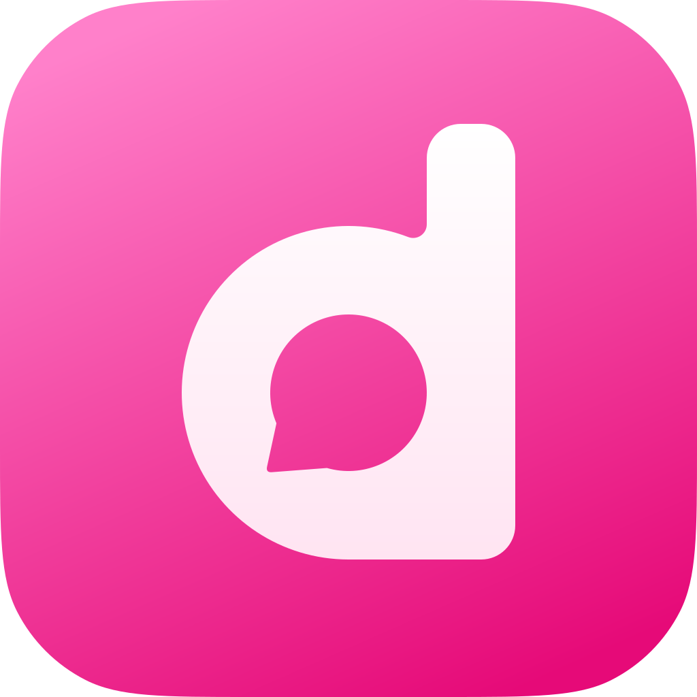
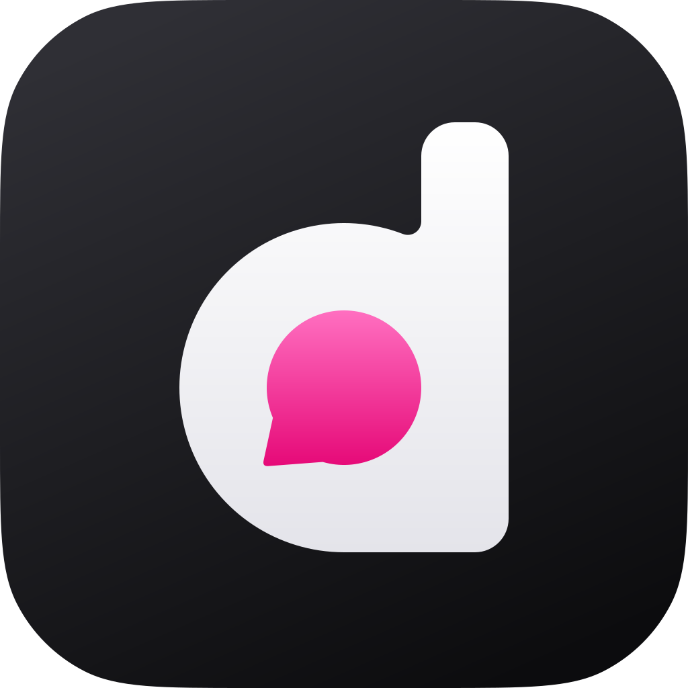
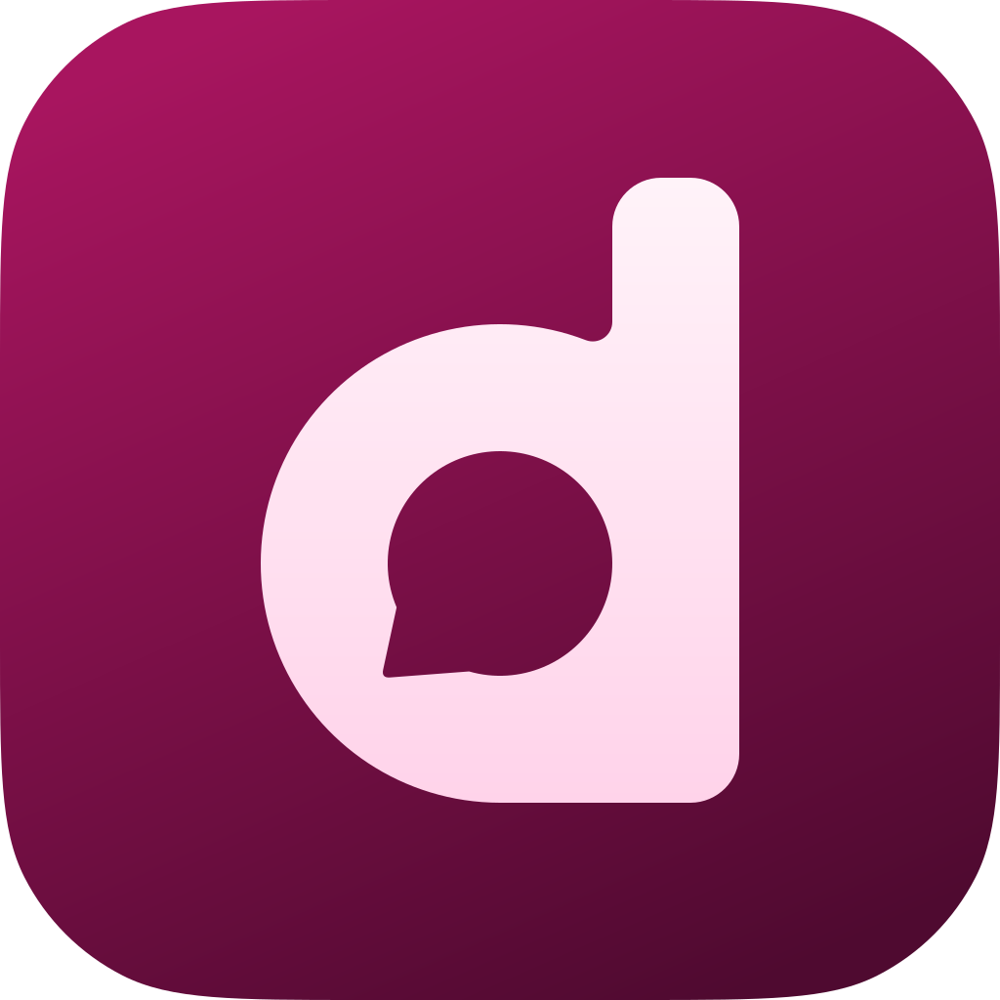
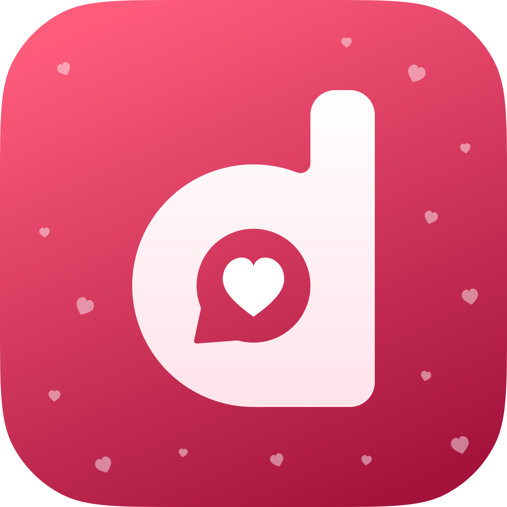
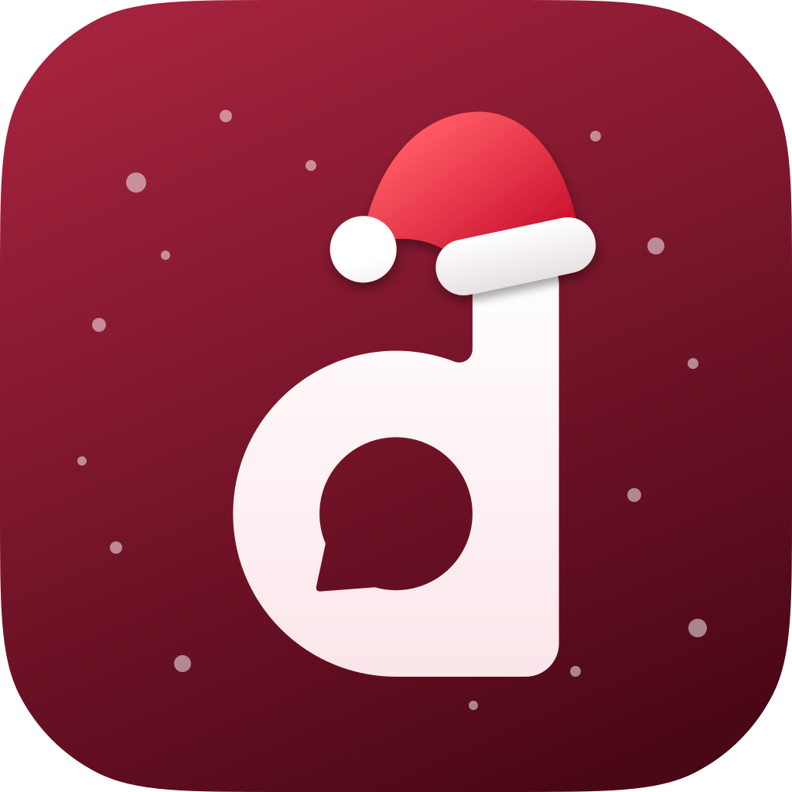

# Diddy-Logo

Das Zeichen ist ein fettes kleines „d“, dessen Innenraum eine Sprechblase ist. Es ist eine reine
Vektorgrafik und in allen Farbtönen exakt dieselbe Form.

<p>
  
  
  
  
  
</p>
<p>
  
  
  
  
  
</p>

## Dateien

Farbtöne: `pink` (Standard), `blue`, `purple`, `black`, `magenta`. Dazu die Anlass-Ausgaben `valentine`,
`easter`, `halloween`, `christmas`, `newyear`. Das sind dieselben Namen wie in der App-Icon-Auswahl.

## Anlass-Ausgaben

Das „d“ bleibt in jeder Ausgabe genau wie im Original (Form, Größe, Lage). Dazu kommen eine Deko und kleine
Formen auf der Kachel:

| Ton | Kachel | Deko (`DECORATIONS`) | Formen (`SCATTER`) | Theme |
|---|---|---|---|---|
| `valentine` | Rosenrot | Herz in der Sprechblase | Herzen | Valentine (hell) |
| `easter` | Frühlingsgrün | Hasenohren | bunte Eier | Easter (hell) |
| `halloween` | Kürbisorange | Hexenhut | Fledermäuse | Halloween |
| `christmas` | Weinrot | Weihnachtsmütze | Schnee | Christmas |
| `newyear` | Mitternachtsblau, goldenes „d“ | Partyhut | Konfetti | New Year |

Hüte und Ohren sitzen auf dem runden Teil des „d“ wie auf einem Kopf (`on_head` in `build.py`), dort hat die
Kachel Platz. Ein neuer Anlass braucht einen Eintrag in `TONES`, eine Zeichenfunktion in `DECORATIONS` und
eine Form in `scatter()`. Danach die ID überall eintragen, wo die anderen Töne stehen; `cinny/tests/themeParity.test.cjs`
und `electron/tests/linuxFeatures.test.cjs` melden fehlende Stellen. Die Themes stehen in `cinny/src/colors.css.ts`,
ihr Fensterhintergrund (Glühen und Formen) in `cinny/src/index.css`.

| Datei | Zweck |
|---|---|
| `logo/diddy-<farbe>-square.svg` | Volle Fläche ohne Rundung. Für iOS, das selbst maskiert. |
| `logo/diddy-<farbe>-rounded.svg` | Abgerundete Kachel. Für Linux, Web und Logos in der App. |
| `logo/diddy-<farbe>-mac.svg` | macOS-Form mit Rand und Schatten. Für das Dock. |
| `logo/diddy-mark.svg` | Nur das Zeichen, einfarbig (`currentColor`). |

## Neu erzeugen

```
python3 branding/build.py
```

Form und Farben stehen oben in `build.py`. Die SVG-Dateien nie von Hand ändern, sie werden überschrieben.
Mit `rsvg-convert` (librsvg) entstehen zusätzlich PNG-Bilder mit 1024 px in `logo/png/`. Dieser Ordner
liegt nicht im Repo.

## Einbauen

```
python3 branding/build.py && python3 branding/export.py
```

`export.py` rendert aus den SVG-Dateien alle Bilder der Apps: `src-tauri/app-icons` und `src-tauri/icons`
(Dock, Fenster, `icon.icns`, `icon.ico`), `cinny/public` (App-Icon-Auswahl, Favicon, Apple- und Android-Symbole)
und die iOS-Asset-Kataloge (App-Icons, Vorschauen, `DiddyLogo`). Die Bilder liegen im Repo, damit Builds
weder `rsvg-convert` noch Python brauchen.

## Stand

Das Logo ist überall eingebaut (1.5.2). Auf iOS gilt der Farbton-Wechsel weiter über die alternativen
App-Icons.
